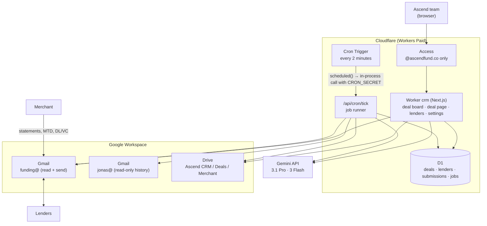
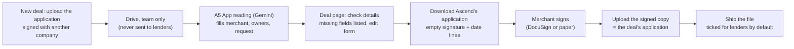
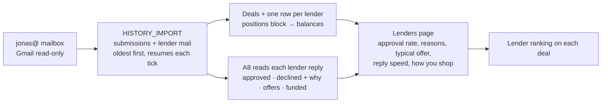
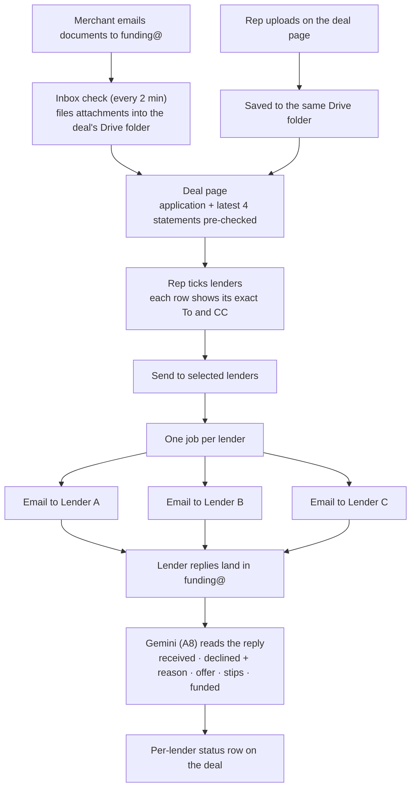
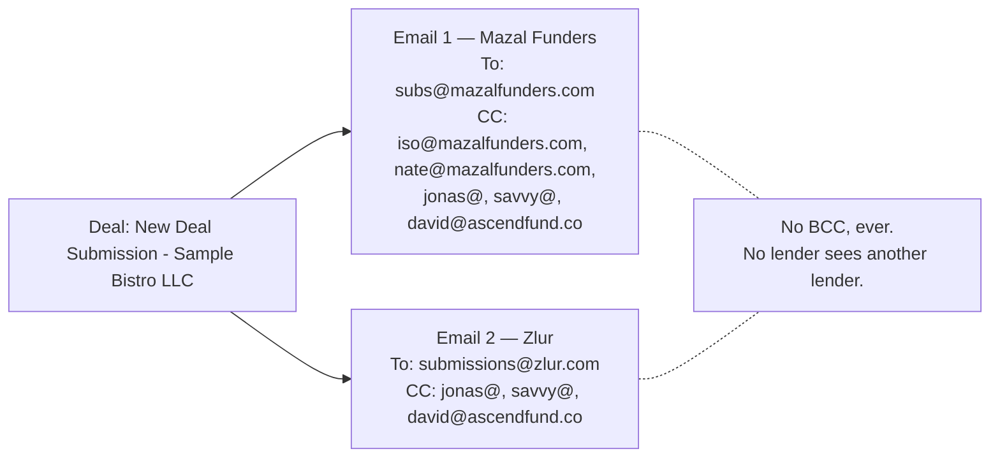
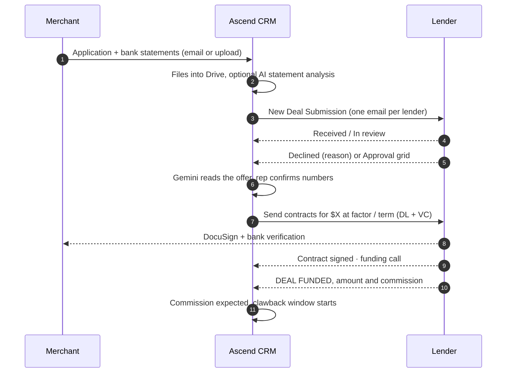
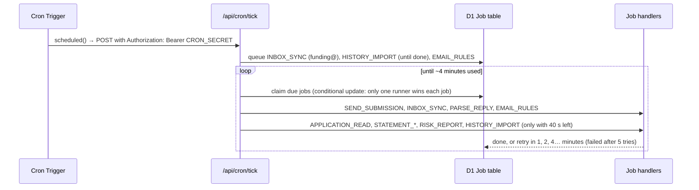
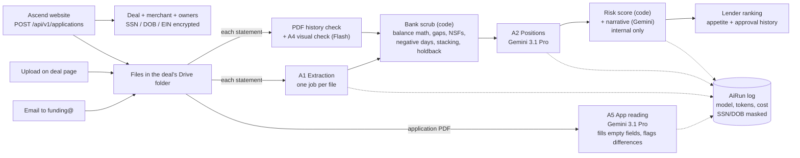
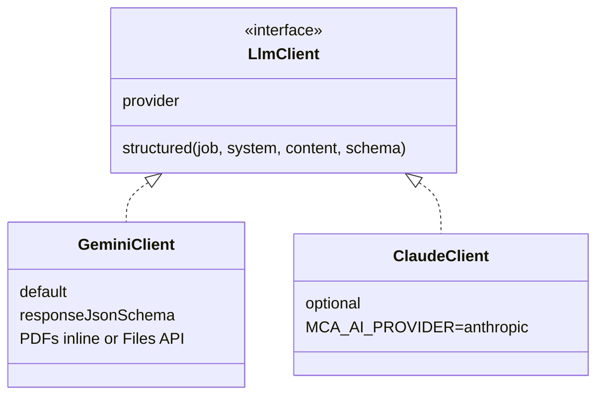
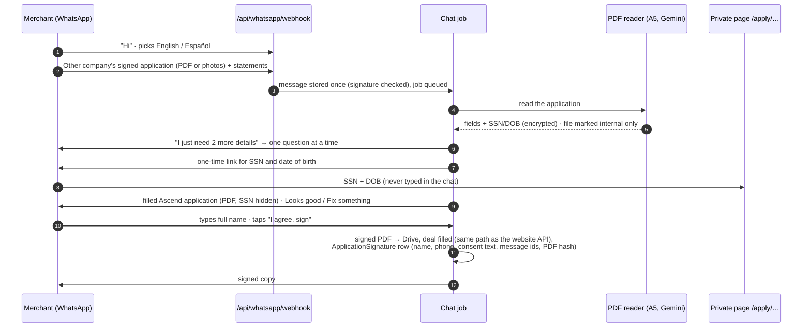

# How the Ascend CRM works

The CRM runs on **Cloudflare**: the app on **Workers**, the database on **D1**, sign-in through
**Cloudflare Access**, and a **Cron Trigger** every 2 minutes for background work. Files live in
**Google Drive**, email goes through the Gmail account `funding@ascendfund.co`, and AI runs on
the **Google Gemini API**. WhatsApp applications are built and switched off. There are no calls
or SMS.

## 1. The pieces

## 1a. From the merchant's application to a signed Ascend application

A returning merchant (same legal name and EIN) keeps one record: the new deal moves onto it and
any differences wait on the deal page for a person to choose.

## 1b. Learning from past email

The same email read from two mailboxes is stored once (by its Message-ID). Imported history
never triggers follow-ups, stip chases or file downloads, and nothing is ever sent from the
history mailbox.

## 2. Ship the file: one email per lender

How each email is addressed (example with two lenders from the roster):

Rules, all enforced in code (`packages/connectors/src/recipients.ts`):

- The lender's first address goes in **To**; its other addresses go in **CC**, then the team.
- Addresses are de-duplicated without regard to case; the sending mailbox is never copied.
- A lender with no address, or picked twice, stops the whole batch before anything is sent.
- A lender already sent this merchant is greyed out (backdoor and duplicate guard).
- Packages over 18 MB go as Drive links shared with that lender's addresses only.
- With `MCA_EMAIL_DRY_RUN` on (the default), the email is written to the deal timeline instead
  of being sent.

## 3. Deal lifecycle

## 4. Background work

A Cloudflare Cron Trigger runs the Worker's `scheduled()` handler every 2 minutes; it calls the
job runner in-process. Work is kept in a `Job` table and each job is a small unit. Clicking
**Send** (or uploading an application) also runs the new jobs right away, in the background of
that request.

A send that crashes after Gmail accepted it is never sent twice: the job marks the submission
"sending" first, and a retry looks in Sent before trying again. D1 has no multi-step
transactions, so every job is written to end in the same state if it is run again.

## 5. From application to Risk Report

The website posts each application to the CRM API (`docs/API.md`); statements can also arrive by
email or upload. Each file starts its own job, so nothing waits on a long request.

Lender replies go through A8 (Gemini 3 Flash) to update each lender's status row.

## 6. Watermarks and email automation

Every PDF in a lender's copy of the package is stamped on each page ("Submitted by Ascend Fund
to <Lender> only · date · Ref <tag>") and carries the tag in its metadata. The tag is stored on
that lender's submission, so a file that turns up elsewhere shows whose copy it was.

| Email                 | To                              | When                                   | Default                         |
| --------------------- | ------------------------------- | -------------------------------------- | ------------------------------- |
| Missing documents     | merchant                        | deal waiting on application/statements | automatic, up to 3, a day apart |
| Stip chase            | merchant                        | a lender asked for something           | automatic, up to 3, a day apart |
| Lender follow-up      | lender, same thread, same To/CC | no reply a day after sending           | automatic, once, weekdays       |
| Contract request      | lender, same thread             | rep clicks on an approved row          | one click, DL/VC attached       |
| Clawback confirmation | lender, same thread             | funded email asks for it               | one click                       |

All of them can be edited or turned off in Settings, skip merchants marked "no automated
emails", follow dry-run mode, and never use BCC.

The AI provider sits behind one interface, so Gemini can be swapped for Claude with one setting:

## 7. WhatsApp applications

The merchant sends the signed application they already have from another company. The bot fills
in Ascend's application from it and the merchant signs Ascend's application by typing their name.
The other company's signature is never copied, and its PDF stays internal.

- Every inbound message and every background result (PDF read, private page, reminder) is a
  `WhatsAppMessage` row handled in order by one `WHATSAPP_MESSAGE` job per chat, so two things
  never change the same chat at once.
- The bot asks only required fields the PDF left empty; values the reader or the answer parser
  was unsure of are read back for a yes/no. "back", "fix" and "agent" work at any point.
- Two reminders inside WhatsApp's free 24-hour window (after 2 h and 20 h); after a day the chat
  is marked "went quiet" on the board and the team follows up.
- With `WHATSAPP_ENABLED` off, replies are written to the chat on the deal page instead of being
  sent.

## Where things live in the code

| Concern                                      | Path                                                                 |
| -------------------------------------------- | -------------------------------------------------------------------- |
| To/CC rules                                  | `packages/connectors/src/recipients.ts`                              |
| House email (subject, body, positions block) | `packages/connectors/src/funder/email.ts`                            |
| Gmail and Drive clients                      | `packages/connectors/src/email/gmail.ts`, `storage/drive.ts`         |
| Job queue                                    | `packages/db/src/jobs.ts`                                            |
| Background jobs (send, inbox, scrub, report) | `apps/web/src/server/jobs/`                                          |
| Website API                                  | `apps/web/src/app/api/v1/`, `docs/API.md`                            |
| Bank scrub checks, risk score, lender rank   | `packages/domain/src/scrub.ts`, `riskScore.ts`, `funderMatch.ts`     |
| Watermark, PDF checks, report PDF            | `packages/connectors/src/pdf/`                                       |
| Email automation                             | `apps/web/src/server/email/`, `server/jobs/emailRules.ts`            |
| WhatsApp bot, questions, signature           | `apps/web/src/server/whatsapp/`, `app/api/whatsapp/webhook/`         |
| WhatsApp Cloud API client, application PDF   | `packages/connectors/src/whatsapp/`, `pdf/application.ts`            |
| Deal page                                    | `apps/web/src/app/deals/[id]/`                                       |
| Ascend application (fill, PDF, signed copy)  | `apps/web/src/server/ascendApplication.ts`, `app/deals/new/`         |
| History import, lender playbook              | `server/jobs/historyImport.ts`, `server/playbook.ts`, `app/lenders/` |
| Sign-in (Cloudflare Access)                  | `apps/web/src/server/auth.ts`                                        |
| Worker entry, cron, bindings                 | `apps/web/worker.ts`, `apps/web/wrangler.jsonc`                      |
| Gemini client                                | `packages/ai/src/providers/gemini.ts`                                |
| Database schema and D1 migrations            | `packages/db/prisma/`, `packages/db/migrations/`                     |
